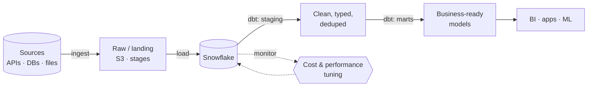

<!-- Header -->
<p align="center">
  
</p>

<p align="center">
  <a href="https://github.com/kyle-mitchell-data">
    
  </a>
</p>

<p align="center">
  
  
  
  
</p>

---

### `SELECT * FROM kyle;`

```sql
SELECT
    'Kyle Mitchell'                                   AS name,
    'Data Platform Engineer'                          AS role,
    '~10 years'                                       AS experience,
    ARRAY_CONSTRUCT('Snowflake', 'dbt', 'AWS', 'Python', 'SQL')
                                                      AS daily_drivers,
    ARRAY_CONSTRUCT('warehouse optimization',
                    'ETL / ELT architecture',
                    'platform modernization')         AS specialties,
    'cost per query goes down, trust in data goes up' AS mission
FROM engineers
WHERE curiosity = 'unbounded'
QUALIFY ROW_NUMBER() OVER (ORDER BY coffee_consumed DESC) = 1;
```

---

### 🧰 Tech stack

<p align="left">
  
  
  
  
  
  
  
  
</p>

<p align="left">
  
  
  
  
  
  
  
  
</p>

---

### 🏗️ How I think about data platforms



- **Snowflake optimization** — warehouse sizing, clustering, query profiling, and squeezing credits until they squeak
- **ETL / ELT architecture** — reusable ingestion patterns that teams can actually follow
- **dbt done right** — layered models, tests, docs, and CI so nobody is afraid to merge
- **Platform modernization** — migrating legacy pipelines into something simpler, cheaper, and observable

---

### 🚧 Currently building

| Project | What it is |
|---|---|
| ✈️ **traveler** | A website that never stays put — it redeploys itself to a random AWS region every few minutes, animates a live "flight" between regions, and serves up facts about wherever it just landed. An excuse to play with AWS architecture. |
| ❄️ **Snowflake + dbt flagship** | A self-deploying Snowflake + dbt project on large public data — spin up a fresh account and watch the whole platform build itself. |
| ⌚ **Garmin Connect IQ** | Custom watch faces, sensor-data capture, and smarter alerts for a Venu 3, written in Monkey C. |

---

### 🔧 Off the clock

- 🖥️ **Homelab** — UniFi network, a PowerEdge waiting for Proxmox, Home Assistant, self-hosted media, and GPU-streamed remote desktop over Tailscale
- 🔌 **Tinkering** — taking electronics apart and building ESP32 / Arduino gadgets nobody asked for
- 🕹️ **Builds** — a DIY arcade cabinet and a large smart art frame in the works
- 📱 **Personal software** — recommendation engines, productivity dashboards, and Android apps built to scratch my own itch
- 🖨️ **Next up** — getting into 3D printing and designing my own parts

---

<p align="center">
  <i>“Make it work, make it right, make it cheap on Snowflake.”</i>
</p>

<p align="center">
  
</p>
